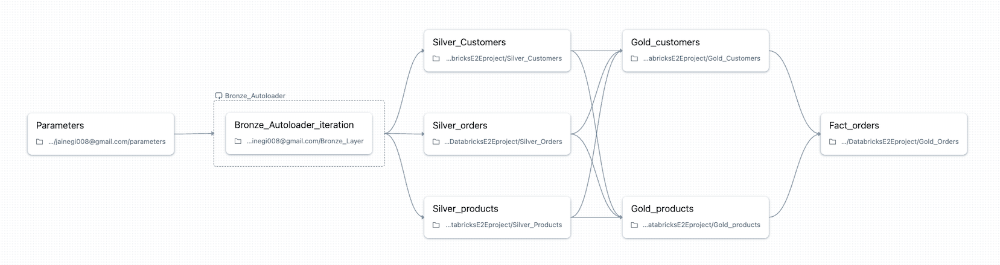
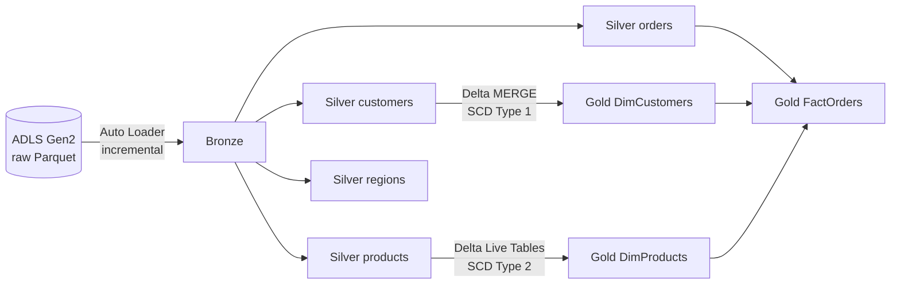
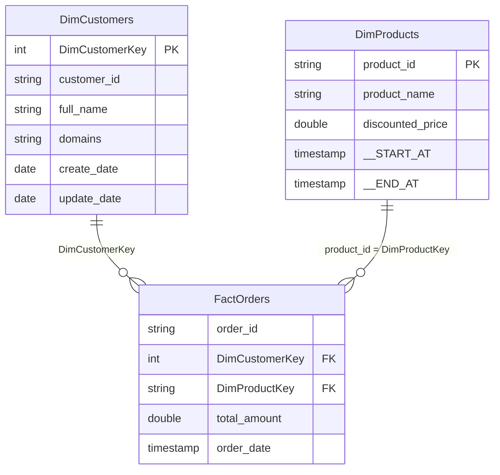
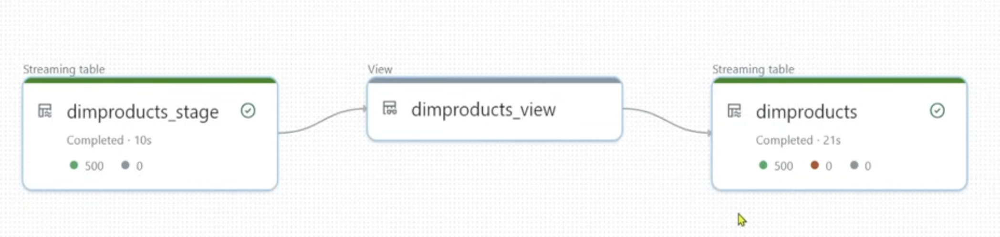

# Databricks Medallion Lakehouse Pipeline

> An end-to-end data engineering pipeline on Azure Databricks that ingests raw sales data incrementally, cleans it, and builds a star schema of analytics-ready fact and dimension tables, governed with Unity Catalog.

      



## What it does

Sales data for orders, customers, products and regions lands as Parquet files in Azure Data Lake Storage. The pipeline:

1. **Ingests incrementally** with Auto Loader, so each run only picks up new files
2. **Cleans and enriches** the data in the silver layer with PySpark
3. **Models it** into a star schema in the gold layer, with slowly changing dimensions so history is preserved
4. **Governs it** in Unity Catalog, with separate bronze, silver and gold schemas

The sample data comes in two batches (`*_first` and `*_second`), so you can run the pipeline twice and watch incremental loads, upserts and SCD history work.

## Architecture



## Pipeline layers

| Layer | Notebook | What happens |
|---|---|---|
| Bronze | `Bronze_Layer.py` | Auto Loader (`cloudFiles`) reads new Parquet files with schema tracking and checkpointing. A parameters notebook passes the dataset list to a Databricks Job, so one notebook ingests orders, customers and products |
| Silver | `Silver_Customers.py` | Derives email domain and full name, writes Delta |
| Silver | `Silver_Orders.py` | Casts timestamps, adds year, ranks orders by value per year with window functions (wrapped in a reusable class) |
| Silver | `Silver_Products.py` | Applies a Unity Catalog SQL function to calculate discounted prices |
| Silver | `Silver_Regions.py` | Cleans the regions reference table |
| Gold | `Gold_Customers.py` | Builds `DimCustomers` with surrogate keys and create and update dates, upserted with Delta `MERGE` (SCD Type 1) |
| Gold | `Gold Products.py` | Delta Live Tables pipeline with data quality expectations, then `apply_changes` to keep full history in `DimProducts` (SCD Type 2) |
| Gold | `Gold Orders.py` | Builds `FactOrders` by joining orders to the customer and product dimension keys, upserted with `MERGE` |

## Data model



## Data quality

The `DimProducts` Delta Live Tables pipeline drops any record that fails these expectations:

| Rule | Check |
|---|---|
| `rule1` | `product_id IS NOT NULL` |
| `rule2` | `product_name IS NOT NULL` |



## Tech stack

| Area | Technologies |
|---|---|
| Platform | Azure Databricks, Databricks Jobs |
| Processing | PySpark, Spark Structured Streaming (Auto Loader, run-once trigger) |
| Storage | Azure Data Lake Storage Gen2, Delta Lake |
| Pipelines | Delta Live Tables with expectations and `apply_changes` |
| Governance | Unity Catalog (catalog, bronze, silver and gold schemas, SQL functions) |
| Modelling | Star schema, surrogate keys, SCD Type 1 and Type 2 |

## Run it yourself

1. Create an Azure Databricks workspace with Unity Catalog and an ADLS Gen2 storage account with `source`, `bronze`, `silver` and `gold` containers
2. Upload the files in `Data/` to the `source` container
3. Create the `databricks_cata` catalog with `bronze`, `silver` and `gold` schemas, and an external location for the storage account
4. Import the notebooks in `Notebooks/` into your workspace and update the storage account name in the paths
5. Create a Databricks Job that runs `parameters.py`, then `Bronze_Layer.py` for each dataset, then the silver and gold notebooks
6. Create a Delta Live Tables pipeline for `Gold Products.py`
7. Run once with the `*_first` files, add the `*_second` files, and run again to see incremental loads and SCD history

## Project structure

```
Data/        Sample Parquet files in two batches
Diagrams/    Pipeline and DLT screenshots
Notebooks/   Bronze, silver and gold notebooks plus job parameters
```

## What I learned

- Auto Loader with a run-once trigger gives incremental ingestion without running a stream all day
- SCD Type 1 and Type 2 suit different dimensions: customers only need the latest values, while product price history matters for analysis
- Delta Live Tables expectations make data quality rules explicit and visible in the pipeline UI

## Next steps

- Move the remaining silver and gold notebooks into Delta Live Tables for one declarative pipeline
- Add a Power BI dashboard on the gold layer
- Add unit tests for the transformation logic and CI to run them

## License

MIT
